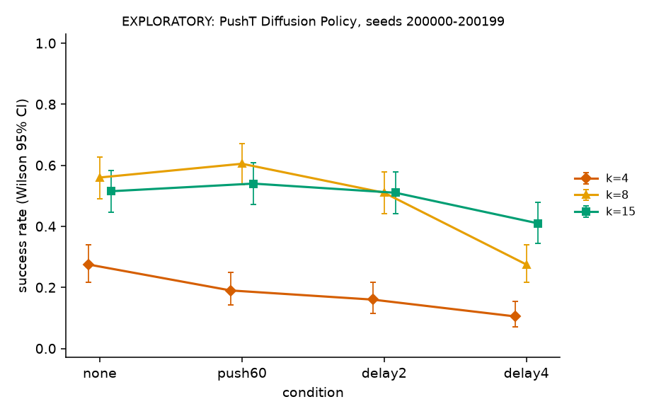
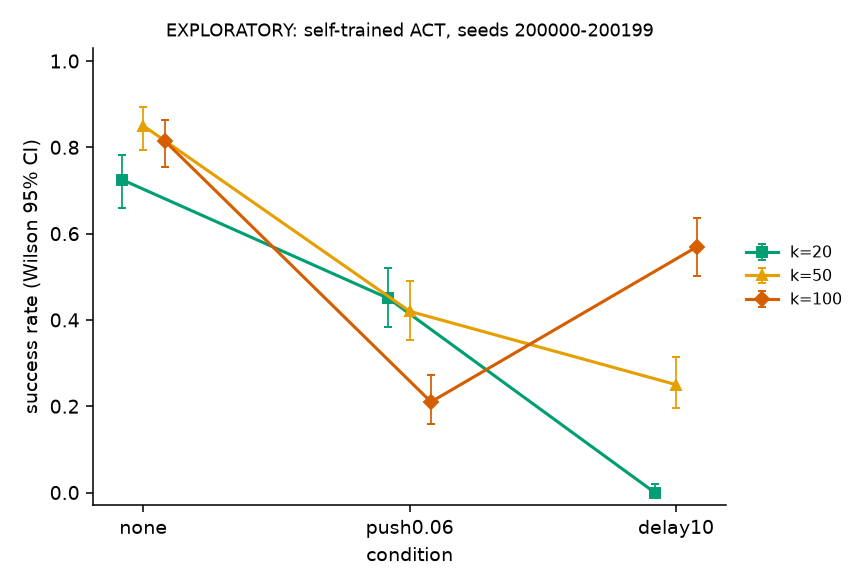
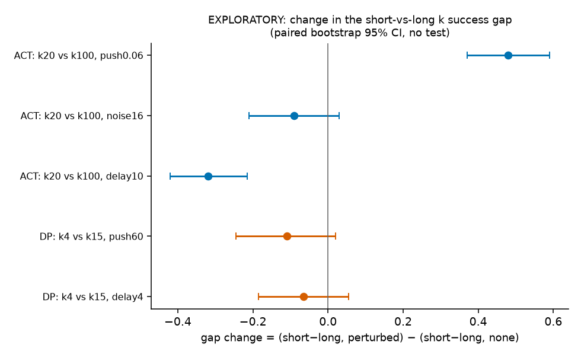
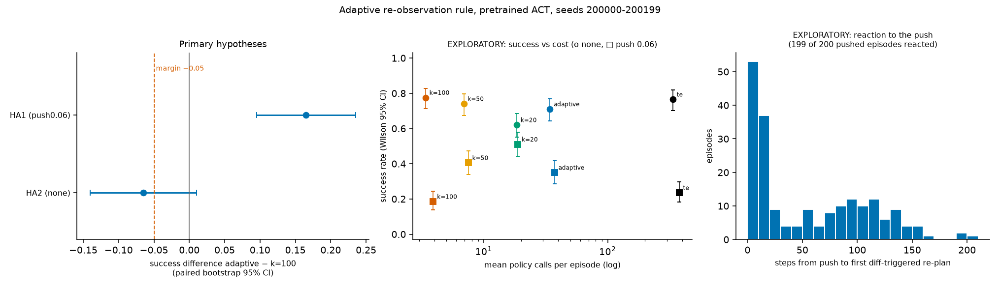

# action-chunk-reobserve: how long should an action chunk be executed before re-observing?

A controlled measurement study of the **execution length *k*** of action chunks in imitation-learning policies
(LeRobot 0.3.3): ACT on the ALOHA sim transfer-cube task, Diffusion Policy on PushT, a self-trained ACT, and a simple
adaptive re-observation rule. It measures how *k* (and temporal ensembling) trade off success against perturbations
(a pushed object, noisy images, delayed actions) and against the number of policy calls. It does not propose a new method.

**Overall conclusion: there is no *k* that is best under every perturbation.**

- **ACT (pretrained).** Pushing the object away favours a short execution length (k=20 beats k=100), action delay favours a long one
  (k=100 beats k=50). Both were pre-registered and are supported.
- **Self-trained ACT** (our own training run of the official recipe; base level 83.2%) reproduces both ACT findings (H1', H3').
- **Diffusion Policy.** "Delay → longer execution is better" also holds (H5 supported). "Push → shorter execution is better" holds
  **only for ACT**: on DP the pre-registered comparison came out the *opposite* way (H4). Most of that gap already exists without any
  perturbation: DP's short k (k=4) is far worse at baseline (see the exploratory gap-change table).
- **Adaptive rule.** A simple rule that re-observes when a freshly predicted chunk disagrees with the current plan beats k=100 under
  a push (HA1 supported), but non-inferiority without perturbation was not shown (HA2), and it did **not** beat the fixed k=50
  while using about 5× as many policy calls.

*Status: all four parts are done (see [Status](#status)); the failure-case analysis is done (exploratory).*

## Research question

ACT-style policies predict a chunk of future actions and execute the first *k* of them before observing and predicting
again. **Under controlled perturbations, how do *k* (and temporal ensembling, which re-predicts at every step) change task
success, the number of policy calls, and action smoothness? Do the findings carry over to another model, another task, and a retrained model?**

## Related work

Citation details are the ones verified in [docs/related_work.md](docs/related_work.md) (checked against arXiv and the
RSS / ICLR pages; the file also lists what is *not* verified).

- **ACT**: T. Z. Zhao, V. Kumar, S. Levine, C. Finn. *Learning Fine-Grained Bimanual Manipulation with Low-Cost Hardware.* RSS 2023. arXiv:2304.13705. Introduces action chunking and temporal ensembling; the model used here.
- **Diffusion Policy**: C. Chi, Z. Xu, S. Feng, E. Cousineau, Y. Du, B. Burchfiel, R. Tedrake, S. Song. *Diffusion Policy: Visuomotor Policy Learning via Action Diffusion.* RSS 2023 (extended version: IJRR 44(10-11)). arXiv:2303.04137. Receding-horizon execution with separate prediction and execution lengths.
- **Bidirectional Decoding (BID)**: Y. Liu, J. Ibn Hamid, A. Xie, Y. Lee, M. Du, C. Finn. *Bidirectional Decoding: Improving Action Chunking via Guided Test-Time Sampling.* arXiv 2024. arXiv:2408.17355. A test-time sampling method for the chunking / reactivity trade-off; not implemented here.
- **Real-Time Chunking (RTC)**: K. Black, M. Y. Galliker, S. Levine. *Real-Time Execution of Action Chunking Flow Policies.* arXiv 2025 (the arXiv page lists NeurIPS 2025). arXiv:2506.07339. Asynchronous execution for flow policies; related to the action-delay perturbation here, not implemented.

## Overview of the four parts

Every part has its own pre-registration file, committed **before any final-evaluation episode of that part was run**
(final seeds ≥ 200000 are blocked by `src/chunkre/seed_guard.py` until the matching file is committed). The registration files are never edited afterwards.

**Note on the registration files.** They are kept exactly as committed, so they reflect the development setup: the repository name
they give (`2181385109/chunk-reobserve`) is the private repository used during development, and this public repository was made from it
by rewriting the history (internal working notes removed, internal labels taken out of commit messages; the remaining files and the commit dates are unchanged).
Commit hashes quoted in the registrations (and the `git_commit` fields in `results/*/config.json`) therefore refer to the development history.
Labels such as "T6a" or "T11a" are the internal task numbers of that work log, and the working note cited once in `PREREGISTRATION_OWN.md`
(for how the training step count was chosen) is not included here; the step rule itself is in `scripts/train_act_tools.py` (`plan_steps`). The hashes quoted in the registrations correspond to these commits in this repository:

<details>
<summary>Development hash → commit in this repository</summary>

| Quoted in a registration | This repository | Commit |
|---|---|---|
| `4b6aadf` | [`27a1523`](https://github.com/2181385109/action-chunk-reobserve/commit/27a1523) | pilot grid (evaluation / perturbation code state for part 1) |
| `6c5302c` | [`1156d73`](https://github.com/2181385109/action-chunk-reobserve/commit/1156d73) | PREREG (part 1) |
| `92027a9` | [`7980e1e`](https://github.com/2181385109/action-chunk-reobserve/commit/7980e1e) | PushT push redraw + DP k=4 check (code state for part 2) |
| `e963f3f` | [`560c58a`](https://github.com/2181385109/action-chunk-reobserve/commit/560c58a) | PREREG-DP (part 2) |
| `300bf15` | [`24690bc`](https://github.com/2181385109/action-chunk-reobserve/commit/24690bc) | PREREG-DP wording fix |
| `7880cb9` | [`9980769`](https://github.com/2181385109/action-chunk-reobserve/commit/9980769) | own-ACT training prep |
| `aac0af2` | [`4ff8e31`](https://github.com/2181385109/action-chunk-reobserve/commit/4ff8e31) | PREREG-OWN (part 3) |
| `073134a` | [`f623255`](https://github.com/2181385109/action-chunk-reobserve/commit/f623255) | adaptive rule implementation |
| `303e3df` | [`89b5307`](https://github.com/2181385109/action-chunk-reobserve/commit/89b5307) | adaptive-rule tuning results |

</details>

| Part | Model / task | Grid | Registration (commit) | Results |
|---|---|---|---|---|
| 1. ACT | pretrained `lerobot/act_aloha_sim_transfer_cube_human`, ALOHA transfer-cube | k ∈ {20, 50, 100, te} × 10 conditions = 40 cells × 200 episodes | [PREREGISTRATION.md](PREREGISTRATION.md) ([`1156d73`](https://github.com/2181385109/action-chunk-reobserve/commit/1156d73)) | [`results/main/`](results/main) |
| 2. Diffusion Policy | `lerobot/diffusion_pusht`, PushT | k ∈ {4, 8, 15} × 4 conditions = 12 cells × 200 episodes | [PREREGISTRATION_DP.md](PREREGISTRATION_DP.md) ([`560c58a`](https://github.com/2181385109/action-chunk-reobserve/commit/560c58a), wording fix [`24690bc`](https://github.com/2181385109/action-chunk-reobserve/commit/24690bc)) | [`results/main_dp/`](results/main_dp) |
| 3. Self-trained ACT | our own ACT, official recipe, 100,000 steps, one run, seed 1000 | k ∈ {20, 50, 100} × 3 conditions = 9 cells × 200 episodes + a 500-episode base-level test | [PREREGISTRATION_OWN.md](PREREGISTRATION_OWN.md) ([`4ff8e31`](https://github.com/2181385109/action-chunk-reobserve/commit/4ff8e31)) | [`results/own_baseline/`](results/own_baseline), [`results/main_own/`](results/main_own) |
| 4. Adaptive rule | pretrained ACT | 2 cells (no perturbation, push 0.06 m) × 200 episodes | [PREREGISTRATION_ADAPTIVE.md](PREREGISTRATION_ADAPTIVE.md) ([`6a1a37b`](https://github.com/2181385109/action-chunk-reobserve/commit/6a1a37b)) | [`results/main_adaptive/`](results/main_adaptive) |

Common to all parts: final seeds **200000–200199**, the same 200 in every cell (a seed fixes the initial scene, so two cells on one seed form a pair);
success = the environment's `is_success` at the end of the episode; test = exact two-sided McNemar on the seed-paired outcomes;
effect size = success-rate difference with a paired bootstrap 95% CI (10,000 resamples, RNG seed 20261007); Holm correction within each part's own family of
primary hypotheses (parts 1–3; part 4 uses none, see there). Code: [`src/chunkre/`](src/chunkre) (evaluation, perturbations, metrics, statistics).
All numbers below come from the json / csv files in the results folders; [`scripts/check_readme_numbers.py`](scripts/check_readme_numbers.py) checks
that the tables in this README agree with them (output: [`results/readme_check.txt`](results/readme_check.txt)).

---

## Part 1: ACT (pretrained) on ALOHA transfer-cube

### Design

| Item | Value |
|---|---|
| Model | `lerobot/act_aloha_sim_transfer_cube_human` (pretrained ACT, chunk size 100; official reported success 83%; our reproduction on 500 episodes: 82.6%, [`docs/ENVIRONMENT.md`](docs/ENVIRONMENT.md) §5) |
| Task | ALOHA sim transfer-cube (`gym_aloha`), 400 steps per episode, 50 Hz |
| Policies (4) | fixed execution length **k ∈ {20, 50, 100}** (execute the first k actions of a predicted chunk, then re-observe; k=100 is the official default); **temporal ensembling (te)**, coefficient 0.01, re-predicts every step |
| Perturbations (10 conditions) | none; **push** the cube by 0.02 / 0.04 / 0.06 m at a random step in [20, 100], random horizontal direction; **image noise** σ = 4 / 8 / 16 (pixel units 0–255, i.i.d. Gaussian on every pixel of every camera at every step, rounded and clipped); **action delay** d = 3 / 5 / 10 steps (60 / 100 / 200 ms; the action executed at step t is the policy output of step t−d, the first d steps hold the initial joint positions) |
| Grid | 4 policies × 10 conditions = **40 cells**, **200 episodes per cell** |
| Renderer | GPU (EGL + Mesa D3D12, RTX 4060 Laptop), batch size 10 environments; the evaluation script aborts if the renderer is not D3D12 |
| Configs | [`configs/main/`](configs/main) |

The noise levels were fixed by a rule written down before a supplementary σ=32 pilot run (if all four policies had ≤2/20
successes at σ=32, use {4, 8, 16}); all four had 0/20 (`results/pilot/pilot_table.md`, seeds 5000–5019), so {4, 8, 16} was used.
k=10 and below are not in the grid (see [Negative and unexpected results](#negative-and-unexpected-results)).

### Pre-registered hypotheses

The three hypotheses come from a 20-episode pilot on other seeds (5000–5019), which is not evidence.

- **H1.** Under push 0.06 m, success of k=20 > k=100.
- **H2.** Under noise σ=16 (the strongest level), success of k=100 > temporal ensembling.
- **H3.** Under action delay 10, success of k=100 > k=50.

The three p-values are corrected together with Holm (α = 0.05).

| H | Condition | A vs B | Success A | Success B | Diff (A − B) | Paired bootstrap 95% CI | Only A / only B | p (McNemar) | p (Holm) | Conclusion |
|---|---|---|---|---|---|---|---|---|---|---|
| H1 | push 0.06 m | k=20 vs k=100 | 0.510 | 0.185 | +0.325 | [+0.245, +0.405] | 76 / 11 | 4.2e-13 | 1.3e-12 | supported |
| H2 | noise σ=16 | k=100 vs te | 0.655 | 0.570 | +0.085 | [+0.000, +0.170] | 47 / 30 | 0.068 | 0.068 | **not supported** (not significant) |
| H3 | delay 10 | k=100 vs k=50 | 0.475 | 0.195 | +0.280 | [+0.190, +0.365] | 74 / 18 | 3.1e-9 | 6.2e-9 | supported |

n = 200 paired seeds per hypothesis. "Only A / only B" = seeds where only A / only B succeeded (the pairs McNemar uses).
No result went in the opposite direction. The analysis ([`scripts/analyze_main.py`](scripts/analyze_main.py)) writes
[`results/main/hypotheses.json`](results/main/hypotheses.json), [`main_cells.csv`](results/main/main_cells.csv) and
[`main_report.md`](results/main/main_report.md) (success rates, secondary metrics, push accounting, all with intervals).


*Success rate for the four policies under each perturbation (0 = no perturbation), Wilson 95% intervals. This figure is a description of all 40 cells, not a set of tests.*


*Cost vs success, one point per cell. Mean policy calls per episode: k=20 ≈ 18–20, k=50 ≈ 7–8, k=100 ≈ 3.4–3.9, te ≈ 336–379. A description, not a test.*


*The three primary comparisons with their paired bootstrap intervals (the tests are in the table above).*

Descriptive observations from the 40-cell table (exploratory, no tests, no correction):

- No fixed k is best in every condition. Without perturbation k=100 has the highest rate (0.775; k=20 has the lowest, 0.620); under push 0.06 k=20 has the highest rate (0.510; k=100 the lowest, 0.185); under delay 5 and 10 temporal ensembling has the highest rate (0.715 and 0.605) and k=20 is at 0.010 and 0.000.
- Under noise, k=50 and k=100 are close at every level (0.835 vs 0.835 at σ=8, 0.635 vs 0.655 at σ=16); k=20 and te are lower.
- Secondary metrics (policy calls, jerk, path length, smoothness) with bootstrap intervals are in [`main_report.md`](results/main/main_report.md). For example, mean jerk without perturbation is 0.0021 for te and 0.0198–0.0209 for fixed k.

<details>
<summary>All 40 cells: successes out of 200 [Wilson 95% CI]</summary>

| condition | k=20 | k=50 | k=100 | te |
|---|---|---|---|---|
| none | 124 [0.551, 0.684] | 148 [0.675, 0.796] | 155 [0.712, 0.827] | 153 [0.702, 0.818] |
| push0.02 | 126 [0.561, 0.694] | 148 [0.675, 0.796] | 136 [0.612, 0.741] | 135 [0.607, 0.736] |
| push0.04 | 117 [0.516, 0.651] | 128 [0.571, 0.703] | 82 [0.344, 0.479] | 89 [0.378, 0.514] |
| push0.06 | 102 [0.441, 0.578] | 81 [0.339, 0.474] | 37 [0.137, 0.245] | 47 [0.182, 0.298] |
| noise4 | 140 [0.633, 0.759] | 157 [0.723, 0.836] | 161 [0.745, 0.854] | 146 [0.665, 0.787] |
| noise8 | 134 [0.602, 0.731] | 167 [0.777, 0.880] | 167 [0.777, 0.880] | 142 [0.644, 0.768] |
| noise16 | 82 [0.344, 0.479] | 127 [0.566, 0.699] | 131 [0.587, 0.717] | 114 [0.501, 0.637] |
| delay3 | 32 [0.116, 0.217] | 138 [0.623, 0.750] | 156 [0.718, 0.832] | 144 [0.654, 0.778] |
| delay5 | 2 [0.003, 0.036] | 117 [0.516, 0.651] | 138 [0.623, 0.750] | 143 [0.649, 0.773] |
| delay10 | 0 [0.000, 0.019] | 39 [0.146, 0.255] | 95 [0.407, 0.544] | 121 [0.536, 0.670] |

</details>

---

## Part 2: Diffusion Policy on PushT (replication on a second model and task)

### Design and registration

[PREREGISTRATION_DP.md](PREREGISTRATION_DP.md) (commit [`560c58a`](https://github.com/2181385109/action-chunk-reobserve/commit/560c58a); one wording fix before any data, [`24690bc`](https://github.com/2181385109/action-chunk-reobserve/commit/24690bc), see [Deviations](#deviations-from-pre-registration)).
Model `lerobot/diffusion_pusht` (official reported success 65.4%), PushT (`gym_pusht`), 300 steps at 10 Hz, DDPM with the official 100 inference steps,
execution length *k* = `n_action_steps` ∈ {4, 8, 15} (15 is the maximum the model allows, 8 the official value), batch size 50.
Conditions (4): none; **push 60** (at a random step in [20, 80] the T block is displaced by 60 PushT units, canvas 0–512, in a random direction, with the direction redrawn
up to 20 times if the displaced block would overlap the agent); **delay 2** and **delay 4** (200 ms and 400 ms). 3 × 4 = **12 cells × 200 episodes**.
Image noise is not in the grid (in the pilot, σ ≤ 16 did not lower DP's success at any k). The hypotheses ask whether two ACT findings generalise:

- **H4** (ACT H1). Under push 60, success of k=4 > k=15.
- **H5** (ACT H3). Under delay 4, success of k=15 > k=8.

The registration states in advance that an opposite result for H4 is realistic, because the pilot showed that k=4 is far below k=15 already without perturbation.
H4 and H5 are corrected together with Holm (a family of two, separate from H1–H3).

### Results

| H | Condition | A vs B | Success A | Success B | Diff (A − B) | Paired bootstrap 95% CI | Only A / only B | p (McNemar) | p (Holm) | Conclusion |
|---|---|---|---|---|---|---|---|---|---|---|
| H4 | push 60 | k=4 vs k=15 | 0.190 | 0.540 | -0.350 | [-0.430, -0.270] | 13 / 83 | 1.2e-13 | 2.4e-13 | **opposite result** |
| H5 | delay 4 | k=15 vs k=8 | 0.410 | 0.275 | +0.135 | [+0.055, +0.215] | 50 / 23 | 0.0021 | 0.0021 | supported |

n = 200 paired seeds per hypothesis. **H4 came out the opposite way**: under the push, k=15 is clearly better than k=4. Most of this gap is not a push effect: without perturbation
k=4 is already at 0.275 against 0.515 for k=15 (the gap-change table below separates the two). **H5 is supported**: with delay, the longer k is better, as in ACT.
Full report with secondary metrics and push accounting: [`main_dp_report.md`](results/main_dp/main_dp_report.md).

<details>
<summary>All 12 cells: successes out of 200 [Wilson 95% CI]</summary>

| condition | k=4 | k=8 | k=15 |
|---|---|---|---|
| none | 55 [0.218, 0.341] | 112 [0.491, 0.627] | 103 [0.446, 0.583] |
| push60 | 38 [0.142, 0.250] | 121 [0.536, 0.670] | 108 [0.471, 0.608] |
| delay2 | 32 [0.116, 0.217] | 102 [0.441, 0.578] | 102 [0.441, 0.578] |
| delay4 | 21 [0.070, 0.155] | 55 [0.218, 0.341] | 82 [0.344, 0.479] |

</details>



*Success rate of the three execution lengths on DP under each condition, Wilson 95% intervals. This figure is a description of the 12 cells, not a test.*

---

## Part 3: self-trained ACT (is it a property of *k* or of one set of weights?)

### Design and registration

[PREREGISTRATION_OWN.md](PREREGISTRATION_OWN.md) (commit [`4ff8e31`](https://github.com/2181385109/action-chunk-reobserve/commit/4ff8e31)).
We trained an ACT ourselves with the official recipe (LeRobot 0.3.3, dataset `lerobot/aloha_sim_transfer_cube_human`, batch size 8, lr 1e-5, **100,000 steps, seed 1000, one run**;
training log in [`results/train_act_own/`](results/train_act_own)). The final checkpoint was fixed as the evaluated one before any evaluation existed; no checkpoint was selected on results.
A **base-level test** (k=100, no perturbation, seeds 1000–1499, 500 episodes; descriptive) comes first, with a registered *weak-model rule*: if the base level were below 0.40 the README must say that the replication is of limited reference value.
Main experiment: k ∈ {20, 50, 100} × {none, push 0.06 m, delay 10} = **9 cells × 200 episodes**, same seeds as part 1.
Hypotheses (replications chosen *because* the pretrained results for H1 and H3 were already known to hold):

- **H1'**. Under push 0.06 m, success of k=20 > k=100.
- **H3'**. Under delay 10, success of k=100 > k=50.

H1' and H3' form their own Holm family of two.

### Results

**Base level:** 416/500 = 0.832 [0.797, 0.862] for the self-trained model, against 413/500 = 0.826 [0.790, 0.857] for the pretrained model (our reproduction) and an official 0.830.
The weak-model rule (below 0.40) was **not triggered**.

| H | Condition | A vs B | Success A | Success B | Diff (A − B) | Paired bootstrap 95% CI | Only A / only B | p (McNemar) | p (Holm) | Conclusion |
|---|---|---|---|---|---|---|---|---|---|---|
| H1' | push 0.06 m | k=20 vs k=100 | 0.450 | 0.210 | +0.240 | [+0.160, +0.320] | 62 / 14 | 2.3e-8 | 2.3e-8 | supported |
| H3' | delay 10 | k=100 vs k=50 | 0.570 | 0.250 | +0.320 | [+0.220, +0.420] | 95 / 31 | 9.6e-9 | 1.9e-8 | supported |

n = 200 paired seeds per hypothesis. Both ACT findings are reproduced by an independently trained model.

<details>
<summary>All 9 cells: successes out of 200 [Wilson 95% CI]</summary>

| condition | k=20 | k=50 | k=100 |
|---|---|---|---|
| none | 145 [0.659, 0.782] | 170 [0.794, 0.893] | 163 [0.755, 0.863] |
| push0.06 | 90 [0.383, 0.519] | 84 [0.354, 0.489] | 42 [0.159, 0.272] |
| delay10 | 0 [0.000, 0.019] | 50 [0.195, 0.314] | 114 [0.501, 0.637] |

</details>



*Success rate of the three execution lengths for the self-trained ACT, Wilson 95% intervals. A description of the 9 cells, not a test.*

**Same-seed agreement with the pretrained model (exploratory, descriptive, no test).** For each cell, the 2×2 table of outcomes of the two models on the same 200 seeds.
Agreement (fraction of seeds with the same outcome) is 0.695–0.815 in the cells where at least one model succeeds at all; the two models are therefore similar in rate but not in which seeds they solve.
(GPU rendering is not bit-for-bit deterministic, so even one model compared with itself would not agree 100%.)

| Item | n | Both succeed | Only self-trained | Only pretrained | Both fail | Agreement | Rate self-trained | Rate pretrained |
|---|---|---|---|---|---|---|---|---|
| k20__none | 200 | 104 | 41 | 20 | 35 | 0.695 | 0.725 | 0.620 |
| k50__none | 200 | 131 | 39 | 17 | 13 | 0.720 | 0.850 | 0.740 |
| k100__none | 200 | 139 | 24 | 16 | 21 | 0.800 | 0.815 | 0.775 |
| k20__push0.06 | 200 | 74 | 16 | 28 | 82 | 0.780 | 0.450 | 0.510 |
| k50__push0.06 | 200 | 60 | 24 | 21 | 95 | 0.775 | 0.420 | 0.405 |
| k100__push0.06 | 200 | 21 | 21 | 16 | 142 | 0.815 | 0.210 | 0.185 |
| k20__delay10 | 200 | 0 | 0 | 0 | 200 | 1.000 | 0.000 | 0.000 |
| k50__delay10 | 200 | 15 | 35 | 24 | 126 | 0.705 | 0.250 | 0.195 |
| k100__delay10 | 200 | 77 | 37 | 18 | 68 | 0.725 | 0.570 | 0.475 |
| base level (k=100, seeds 1000–1499) | 500 | 372 | 44 | 41 | 43 | 0.830 | 0.832 | 0.826 |

---

## Exploratory: how much does a perturbation change the short-vs-long gap?

**EXPLORATORY: no significance test, no correction, not evidence. The ACT (pretrained) part was added post hoc, after the ACT data had been seen** (the DP and self-trained parts were specified before their data existed, but after the ACT results were known).
The raw comparison "short k vs long k under a perturbation" mixes two things: a short k may simply be worse (or better) at baseline, or it may be more affected by the perturbation. For a short *S*, a long *L* and a perturbed condition *C*:

`gap change = [rate(S, C) − rate(L, C)] − [rate(S, none) − rate(L, none)]`

(mean over the paired seeds, paired bootstrap 95% CI). Positive = the short k loses less (or gains more) from the perturbation than the long k does; negative = the opposite.
ACT and the self-trained ACT use k=20 vs k=100; DP uses k=4 vs k=15.

| Model | Short vs long | Condition | Short, perturbed | Long, perturbed | Gap (perturbed) | Short, none | Long, none | Gap (none) | **Gap change** | Paired bootstrap 95% CI |
|---|---|---|---|---|---|---|---|---|---|---|
| ACT (pretrained) | k=20 vs k=100 | push0.06 | 0.510 | 0.185 | +0.325 | 0.620 | 0.775 | -0.155 | **+0.480** | [+0.370, +0.590] |
| ACT (pretrained) | k=20 vs k=100 | noise16 | 0.410 | 0.655 | -0.245 | 0.620 | 0.775 | -0.155 | **-0.090** | [-0.210, +0.030] |
| ACT (pretrained) | k=20 vs k=100 | delay10 | 0.000 | 0.475 | -0.475 | 0.620 | 0.775 | -0.155 | **-0.320** | [-0.420, -0.215] |
| ACT (self-trained) | k=20 vs k=100 | push0.06 | 0.450 | 0.210 | +0.240 | 0.725 | 0.815 | -0.090 | **+0.330** | [+0.225, +0.430] |
| ACT (self-trained) | k=20 vs k=100 | delay10 | 0.000 | 0.570 | -0.570 | 0.725 | 0.815 | -0.090 | **-0.480** | [-0.575, -0.385] |
| DP | k=4 vs k=15 | push60 | 0.190 | 0.540 | -0.350 | 0.275 | 0.515 | -0.240 | **-0.110** | [-0.245, +0.020] |
| DP | k=4 vs k=15 | delay4 | 0.105 | 0.410 | -0.305 | 0.275 | 0.515 | -0.240 | **-0.065** | [-0.185, +0.055] |



*Gap change for ACT (pretrained) and DP, with paired bootstrap 95% intervals. A description, not a test; the self-trained ACT is in the table above.*

What the table shows, descriptively: for ACT, pushes move the gap strongly towards the short k (+0.480; +0.330 for the self-trained model) and delay strongly towards the long k (-0.320; -0.480).
For DP the push does **not** move the gap towards the short k. The gap between k=4 and k=15 is already -0.240 without perturbation and -0.350 under push 60, so most of it exists before any push.
The remaining change of -0.110 points towards the short k being hurt *more* by the push, but its interval [-0.245, +0.020] includes 0, so there is no evidence for that either.
The conclusion is unchanged: "push → shorter execution is better" does not hold on DP, unlike ACT.
Under delay 4 the gap change on DP is -0.065 (interval [-0.185, +0.055] includes 0), in the same direction as for ACT but not evidence of an effect.

---

## Part 4: an adaptive re-observation rule (pretrained ACT)

### The rule

Instead of a fixed *k*, the policy keeps executing its current 100-step plan, and **every m = 10 steps it predicts a candidate chunk** (one extra policy call) and compares
the candidate's first h_cmp = 20 actions with the 20 actions of the current plan it would execute next (mean L2 distance over the 14-dimensional ALOHA action vector, which includes the two gripper channels).
If the difference is **> tau = 0.2906** and at least **min_gap = 20** steps have passed since the last re-plan, it switches to the candidate. It also re-plans when the 100-step block is used up.
Policy calls per episode = 1 + block-exhausted re-plans + comparisons. The rule is implemented in [`src/chunkre/adaptive.py`](src/chunkre/adaptive.py) without touching LeRobot; with tau = ∞ it reproduces k=100 episode by episode on the 10 test episodes (check A1, CPU rendering, [`results/t11_checks/`](results/t11_checks/checks.md)).
Cost: it is **not cheap in calls** (stated in the registration before the run).

### How the parameters were chosen

On tuning seeds 6000–6049 (never used for final results): 2 values of m (10, 20) × 5 values of tau (the 50/75/90/95/99% quantiles of the difference distribution without perturbation) = **10 combinations**, each in 2 conditions (none, push 0.06 m), **50 episodes** per cell
([`results/tune_adaptive/selection.md`](results/tune_adaptive/selection.md)). A rule fixed before the tuning data existed picked the combination that keeps the no-perturbation rate within 3 points of k=100 and has the best push rate: m=10, tau=0.2906.
The selected combination's tuning push result was 20/50 = 40.0%, the highest of the 6 eligible combinations (the other five were at 12–14/50), so the registration states in advance that the final result is expected to be lower (winner's curse).

### Registration and hypotheses

[PREREGISTRATION_ADAPTIVE.md](PREREGISTRATION_ADAPTIVE.md) (commit [`6a1a37b`](https://github.com/2181385109/action-chunk-reobserve/commit/6a1a37b)): 2 cells, `ad__none` and `ad__push0.06` × 200 episodes, seeds 200000–200199, compared with the **k=100 cells of part 1** (same seeds, not re-run).
No Holm correction: "the rule is useful on this task" is claimed only if both hypotheses hold.

- **HA1.** Under push 0.06 m, the adaptive rule's success > k=100 (exact McNemar, two-sided, α = 0.05).
- **HA2.** Without perturbation, the adaptive rule is not worse than k=100 by more than 5 percentage points (lower limit of the paired bootstrap 95% CI of adaptive − k=100 is > −0.05; McNemar only descriptive).

### Results

| H | Condition | A vs B | Success A | Success B | Diff (A − B) | Paired bootstrap 95% CI | Only A / only B | p (McNemar) | Conclusion |
|---|---|---|---|---|---|---|---|---|---|
| HA1 | push 0.06 m | adaptive vs k=100 | 0.350 | 0.185 | +0.165 | [+0.095, +0.235] | 44 / 11 | 8.7e-6 | supported |
| HA2 | no perturbation | adaptive vs k=100 | 0.710 | 0.775 | -0.065 | [-0.140, +0.010] | 23 / 36 | 0.12 (descriptive) | non-inferiority **not shown** (lower limit ≤ −0.05) |

n = 200 paired seeds. Registered conclusion: **HA1 supported, but non-inferiority without perturbation (HA2) is not shown**, so the rule is not claimed to be useful. The registration notes that with 200 pairs the interval is about ±6 points wide, so
"not shown" means "not shown at this sample size", not "worse". Report: [`main_adaptive_report.md`](results/main_adaptive/main_adaptive_report.md).

**Descriptive comparison with the fixed policies** (exploratory; no tests; paired bootstrap interval for adaptive − policy; k=50 is the cheaper fixed control, named in advance, and is reported whatever the result):

| Condition / policy | Successes | Rate | Wilson 95% CI | Mean policy calls | Adaptive − policy (paired bootstrap 95% CI) |
|---|---|---|---|---|---|
| none / k=20 | 124/200 | 0.620 | [0.551, 0.684] | 18.5 | +0.090 [+0.010, +0.170] |
| none / k=50 | 148/200 | 0.740 | [0.675, 0.796] | 6.9 | -0.030 [-0.105, +0.045] |
| none / k=100 | 155/200 | 0.775 | [0.712, 0.827] | 3.4 | -0.065 [-0.140, +0.010] |
| none / te | 153/200 | 0.765 | [0.702, 0.818] | 335.6 | -0.055 [-0.125, +0.015] |
| none / adaptive | 142/200 | 0.710 | [0.644, 0.768] | 34.2 | — |
| push0.06 / k=20 | 102/200 | 0.510 | [0.441, 0.578] | 18.8 | -0.160 [-0.235, -0.080] |
| push0.06 / k=50 | 81/200 | 0.405 | [0.339, 0.474] | 7.5 | -0.055 [-0.125, +0.015] |
| push0.06 / k=100 | 37/200 | 0.185 | [0.137, 0.245] | 3.9 | +0.165 [+0.095, +0.235] |
| push0.06 / te | 47/200 | 0.235 | [0.182, 0.298] | 377.9 | +0.115 [+0.050, +0.185] |
| push0.06 / adaptive | 70/200 | 0.350 | [0.287, 0.418] | 37.4 | — |

The adaptive rule is above k=100 and te under a push, but **it is not above the fixed k=50**: its point estimate is lower in both conditions (intervals include 0), and it uses about 5× as many policy calls
(34.2 vs 6.9 without perturbation, 37.4 vs 7.5 under push; ratio ≈5×). k=20 is higher than the adaptive rule under a push and lower without perturbation.

**Reaction to the push (descriptive).** In `ad__push0.06`, 199 of 200 pushed episodes had a difference-triggered re-plan after the push; the number of steps from the push to the first such re-plan has median 30, Q1 9, Q3 97.5, range 1–204,
and 30.2% / 46.7% / 50.3% of the episodes with a reaction re-planned within 10 / 20 / 30 steps. A re-plan is not necessarily caused by the push: the rule also re-plans in 91.0% of the no-perturbation episodes (4.32 difference-triggered re-plans per episode), against 99.5% of the pushed episodes (6.59 per episode),
so these timings are not a clean measure of "reaction to the push". In 2 episodes the first re-plan happened exactly at the push step (the policy had not yet seen the pushed scene) and is reported separately, see [Deviations](#deviations-from-pre-registration).



*Left: the two primary differences with 95% CIs (HA1, HA2; the registered tests). Middle: success vs mean policy calls (log scale) for all five policies, circles = no perturbation, squares = push 0.06 m, a description. Right: steps from the push to the first difference-triggered re-plan, a description, not a test.*

---

## Failure analysis (exploratory)

**Exploratory and descriptive only: debugging seeds 7000–7049, 50 episodes per cell, no hypothesis test; the mechanisms below are explanations that fit the data, not demonstrated causes.** Pretrained ACT, 7 cells (k=20 and k=100 × {none, push 0.06 m, delay 10}, plus k=50 under delay 10); every number is read from [`results/failure/failure_summary.json`](results/failure/failure_summary.json) (full report: [`failure_report.md`](results/failure/failure_report.md); definitions fixed before the data: [`definitions.md`](results/failure/definitions.md)). An episode is "never lifted" if the cube never rose 0.04 m (one cube edge) above the table, and "lifted, not finished" if it did but the task still failed. The same seed gives the same push time in both cells.

**Push 0.06 m: why k=100 fails more often.**
- Steps from the push to the first re-prediction: median 11 (k=20) vs 41 (k=100).
- Plan age when the right gripper closes after the push (how many steps earlier the executed chunk was predicted): median 13 (k=20) vs 58 (k=100).
- Horizontal distance between the grasp point (midpoint of the right fingertips) and the cube centre at that closing: median 0.013 m (k=20) vs 0.038 m (k=100); the cube edge is 0.04 m.
- Never lifted: 19/50 (k=20) vs 29/50 (k=100).
- Reading that fits the data: in no episode did the gripper close before the first re-prediction after the push, so k=100 is not grasping with the plan made before the push; one plan is executed open-loop for about 58 steps, and the deviation caused by the push is not corrected during that time.


*Histograms over the 50 episodes per cell: steps from the push to the first re-prediction (left) and horizontal grasp-point–cube distance at the first closing after the push (right), k=20 vs k=100, push 0.06 m (exploratory, seeds 7000–7049).*

**Delay 10: why k=20 fails everywhere.**
- At each chunk switch the first executed action jumps (12 joints, L2): median 0.172 rad for k=20, against 0.008 rad between adjacent steps inside a chunk.
- The jump points backwards (negative cosine with the motion over the previous 5 steps) in a share of 1.00 of the switches (k=20).
- Chunk switches per episode: 19 for k=20, about 3 for k=100.
- Never lifted: 49/50 for k=20. k=50 fails differently: 32/50 lifted the cube and did not finish.
- Reading that fits the data: with a 10-step delay the new plan is built from a state the arm has already left, so every switch pulls the arm back; k=20 does this 19 times per episode and never gets to the cube, while k=100 does it about 3 times.


*One k=20, delay-10 failure (seed 7000, never lifted), right-arm channels: executed action (solid) vs observed position (dashed); dotted lines mark the first executed action of each new chunk (exploratory).*

---

## Negative and unexpected results

- **H2 is not supported.** Under σ=16, k=100 is ahead of temporal ensembling by 8.5 points (47 vs 30 discordant seeds), but the paired CI [0.000, 0.170] reaches 0 and the Holm-adjusted p is 0.068 (the same as the raw p, because H2 has the largest raw p of the three). The data do not show a difference between k=100 and te at this noise level, and they do not show that there is none; with 200 pairs the interval is wide.
- **DP H4 came out the opposite way.** Under push 60, k=4 is *worse* than k=15 (0.190 vs 0.540, Holm p 2.4e-13). The registration anticipated this: k=4 is far below k=15 already without perturbation (0.275 vs 0.515). Of the -0.350 gap under the push, -0.240 is already there without perturbation; the remaining exploratory gap change (-0.110, interval [-0.245, +0.020]) points towards the short k being hurt more by the push, but the interval includes 0, so there is no evidence for it. Either way, "push → shorter is better" does not hold on DP; it is an ACT result in this study, not a general one.
- **The adaptive rule did not beat the fixed k=50.** Under push it is at 0.350 against 0.405 (difference -0.055, interval [-0.125, +0.015]) while using about 5× as many policy calls; without perturbation it is at 0.710 against 0.740. A cheap fixed k=50 is at least as good on this task.
- **Winner's curse.** The adaptive rule's push result was 20/50 = 40.0% on the tuning seeds, where it was selected as the best of 6 eligible combinations; on the final seeds it is 70/200 = 35.0%. The registration had predicted a lower final value. Even the lower number is a result for a selected setting, not a clean estimate of "an adaptive rule".
- **Short execution lengths stall the arm.** With k = 1, 2, 5 ACT succeeded in 0/20 episodes (seeds 0–19, [`results/t3_k1_diag/`](results/t3_k1_diag/README.md)); at k=1 the arm stays near its starting pose and does not go for the cube (the predicted chunk starts almost in place, so executing only its first actions never gets going; checked against LeRobot's own evaluator). k=10 had 6/20 in that diagnosis and 0–1/20 in every pilot condition (seeds 5000–5019, `results/pilot/pilot_table.md`), so k ≤ 10 was left out of the main grid.
- **Strong noise removes all successes.** At σ=32 all four policies (k=20, 50, 100, te) had 0/20 (pilot), which is why the main noise levels stop at σ=16.
- **Temporal ensembling does not protect against pushes.** Under push it is close to k=100: 0.675 vs 0.680 (0.02 m), 0.445 vs 0.410 (0.04 m), 0.235 vs 0.185 (0.06 m); the Wilson intervals overlap in every case (not tested).
- **Temporal ensembling costs about 100× more policy calls.** Mean calls per episode without perturbation: te 335.6 vs k=100 3.4 (ratio ≈ 99); under delay 10: 379.3 vs 3.9 (≈ 97). Whether the extra calls are worth it depends on the perturbation: te is the best cell under delay 10 (0.605 vs 0.475 for k=100, not tested) and elsewhere it is not clearly ahead of k=100 (intervals overlap; not tested).
- **k=20 collapses under delay.** 0.160 / 0.010 / 0.000 at d = 3 / 5 / 10 (vs 0.620 without delay). This was already visible in the pilot; k=20 stays in the grid because H1 needs it.

## Limitations

- **One task per model.** ACT is tested only on ALOHA transfer-cube and DP only on PushT; nothing here says the picture holds for other tasks, other models, or real robots.
- **The self-trained model is one training run (one seed).** It reproduces the ACT findings, but a second run could differ; agreement with the pretrained model on individual seeds is only 0.695–0.815.
- **The adaptive rule was lightly tuned and is costly.** Only 10 (m, tau) combinations, 50 episodes each, were tried; the difference is computed on the 14-dimensional action vector including the gripper channels (not joints only); with m=10 some comparisons cannot trigger a re-plan (the 20-step minimum gap) but still cost a policy call.
- GPU (D3D12) rendering is not bit-for-bit deterministic, so a re-run with the same seeds can differ in individual episodes; the study is statistically reproducible, not exactly reproducible. (CPU rendering is deterministic but about 4–5× slower.)
- The hypotheses and perturbation levels were chosen from small pilots (20 episodes for ACT, 50 per cell for DP and the adaptive tuning), so the design is shaped by earlier looks at (other-seed) data, though not by the final seeds. H1'/H3' were chosen because H1/H3 were known to hold; the ACT gap change is post hoc.
- The perturbations are hand-designed (push distance and window, i.i.d. pixel noise, constant delay) and may not resemble real disturbances; the pixel noise is clipped, so the realised noise is smaller than σ (about 0.82σ on ALOHA images).
- 200 episodes per cell give Wilson intervals about ±7 points at a rate of 0.5; differences of a few points (and all "best policy" statements) are within noise.
- Secondary metrics are averages over successes and failures together, so they mix behaviour with outcome.
- In the PushT push-the-T perturbation (Diffusion Policy) the push direction excludes directions in which the pushed block would overlap the agent: an overlapping direction is redrawn from the episode's own generator (up to 20 times), so the realised direction distribution is slightly tilted away from the agent.
- **Portability.** The scripts were run only under Windows + WSL2. Paths that are still fixed: the self-trained checkpoint
  `/root/train_out/act_own/checkpoints/100000/pretrained_model` (named in `PREREGISTRATION_OWN.md` and used by `configs/main_own/*.yaml`,
  `src/chunkre/main_own.py` and the guard demos; `train_act.sh` writes it there by default, `OUT` changes only the training output);
  `scripts/check_version_candidates.sh` (a one-off version probe) uses `/root/venvs/`; some checks use scratch directories under `/tmp`.
  The `run_*.sh` wrappers that evaluate ACT on ALOHA keep the D3D12 renderer check,
  so on native Linux they stop at the first ACT cell; running those cells there needs `scripts/eval.py --allow-cpu-render` directly, with a different renderer than the one used here.
  Logs and `config.json` files under `results/` record the absolute paths of the machine they were produced on.

## Reproduce

**Prerequisites: Windows + WSL2** (Ubuntu 24.04, Python 3.12, LeRobot 0.3.3, an NVIDIA GPU; MuJoCo renders on the GPU through WSL's Mesa D3D12 driver).
All scripts run inside WSL as root and locate the repository from their own path, so they work from any directory. Below, `<repo>` is the
path of this repository as seen from WSL (for example `/mnt/c/src/action-chunk-reobserve`). The virtual environment and the Hugging Face cache
default to `/root/venvs/chunk-reobserve` and `/root/.cache/huggingface` (override with `CHUNK_VENV` / `HF_HOME`). From Windows, with Git Bash:

```bash
export MSYS_NO_PATHCONV=1
W="wsl.exe -d Ubuntu-24.04 -u root -- bash <repo>/scripts"
$W/setup_env.sh          # creates the venv, installs pinned versions (requirements.lock.txt)
$W/run_main.sh           # part 1: ACT, all 40 cells x 200 episodes; resumable; runs the analysis at the end
$W/run_main_dp.sh        # part 2: DP, 12 cells x 200 episodes; resumable; runs analyze_main_dp.py + analyze_interaction.py
$W/train_act.sh          # part 3: train the ACT (100,000 steps, resumable)
$W/run_main_own.sh       #         base-level test, then 9 cells x 200 episodes; runs analyze_main_own.py
$W/run_tune_adaptive.sh  # part 4: threshold tuning, 22 cells x 50 episodes (seeds 6000-6049)
$W/run_main_adaptive.sh  #         2 cells x 200 episodes; checks the registration is committed and the parameters match it; runs analyze_main_adaptive.py
```

Each run script takes a cell subset (see its header) and prints its own time estimate at start; keep other GPU jobs off the machine. In our run the summed batch wall time of the
40 ACT cells was 13.75 h. Then:

```bash
$W/test.sh                                        # unit tests (no simulation) + the README number check
$W/t10a_py.sh scripts/analyze_main.py             # part 1 report + hypotheses.json + exploratory figures
$W/t10a_py.sh scripts/make_main_figures.py --copy-to docs/figures   # fig_main.png, fig_cost.png
$W/t10a_py.sh scripts/check_readme_numbers.py     # checks this README's tables against results/ (writes results/readme_check.txt)
```

(`scripts/t10a_py.sh` runs a Python script inside the project environment; inside a WSL shell you can equally `source scripts/env.sh` and call `python` directly.)

**Native Linux (not tested).** On Ubuntu 24.04 with an NVIDIA driver, run the same scripts from the repository root without `wsl.exe`
(`bash scripts/setup_env.sh`, then e.g. `bash scripts/run_main.sh`); `setup_env.sh` installs system packages with `apt-get`, so it needs root
(or install the packages listed in it yourself and set `CHUNK_VENV` / `HF_HOME` to writable paths). The ALOHA (ACT) evaluation refuses to run unless the
renderer is Mesa D3D12, which exists only under WSL; on native Linux pass `--allow-cpu-render` to `scripts/eval.py` (it accepts any non-D3D12 renderer).
The `run_*.sh` wrappers do not pass this flag (see [Limitations](#limitations)). PushT (Diffusion Policy) does not use OpenGL and is not affected.

Details of the environment, rendering and timing: [docs/ENVIRONMENT.md](docs/ENVIRONMENT.md).

## Deviations from pre-registration

The registration files were never edited after their commit, except for the one wording fix in (b). Each item below is a departure or a clarification, listed in full:

- **(a) ACT: a plotting bug fix in the analysis code.** `scripts/analyze_main.py` crashed while drawing `fig_delay.png`
  (`ValueError: 'yerr' must not contain negative values`), because the Wilson lower bound of the 0/200 cell `k20__delay10`
  is +1.7e-18 and the error-bar length "estimate − lower bound" came out as −1.7e-18. The fix clips the *drawn* error-bar length to ≥ 0
  (`yerr_from_ci` in `src/chunkre/plotting.py`, with a unit test in `tests/test_plotting.py`). No statistic was changed:
  `hypotheses.json` (written before the crash) and the rerun are byte-identical (SHA-256 `ea6bfbb8…4eb0`), and so are `main_cells.csv`.
  The fix was made after the final data were collected but does not touch any computation.
- **(b) DP: one wording correction in the registration, before any data.** Commit [`24690bc`](https://github.com/2181385109/action-chunk-reobserve/commit/24690bc) (after `560c58a`, before any DP final-evaluation episode) removed delay 2 from the DP gap-change list and reworded the note on reward reproducibility (2 lines). No hypothesis, test, grid or seed was changed.
- **(c) Adaptive: "first re-plan after the push" is implemented as t > push_step.** The registration says "at or after the push". The push is applied at the end of step `push_step`, after the policy has chosen that step's action, so the policy first sees the pushed scene at `push_step + 1`; a re-plan at exactly `push_step` used the pre-push picture and is not a reaction.
  The 2 episodes in which the first difference-triggered re-plan fell exactly on `push_step` are reported separately. This affects only the descriptive reaction-time distribution, not HA1 or HA2.
- **(d) Adaptive: HA1, HA2 and the 5-point margin were fixed after the tuning run had been seen**, but before any final seed was used (the registration says so in its §7). Tuning used seeds 6000–6049 only; the final seeds 200000–200199 were not used for tuning in any form.

There are no other deviations.

## Status

| Part | State |
|---|---|
| 1. ACT main experiment | done |
| 2. Diffusion Policy replication | done |
| 3. Self-trained ACT replication | done |
| 4. Adaptive re-observation rule | done |
| Failure-case analysis | done (exploratory) |

How this project was done. I used Claude (an AI assistant) to write the code, to draft the documentation, and as a discussion partner for the experimental design. I decided the scope, approved each design choice and pre-registration before data were collected, and ran all experiments on my own machine. Every number reported here is recomputed from the raw per-episode files by scripts in this repository.

License: [MIT](LICENSE).
