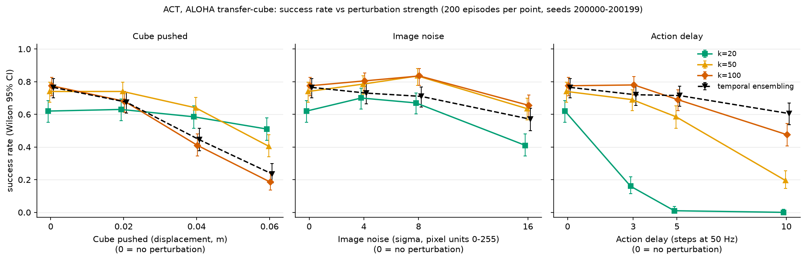
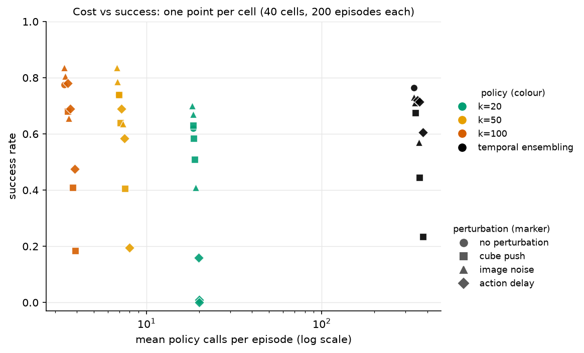
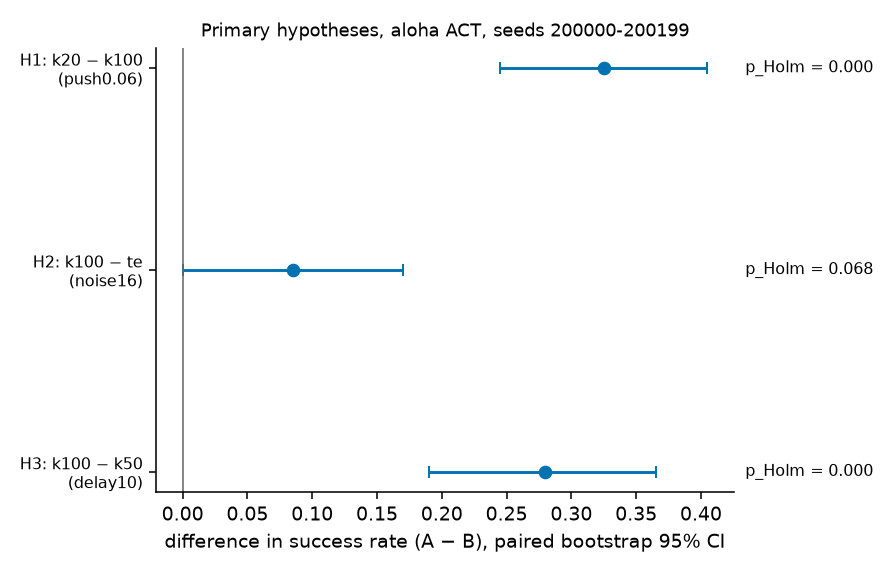

# chunk-reobserve: how long should an action chunk be executed before re-observing?

A controlled measurement study of **ACT** on the ALOHA sim transfer-cube task (LeRobot 0.3.3). It measures how the
execution length *k* of an action chunk, and temporal ensembling, trade off success against perturbations
(a pushed object, noisy images, delayed actions) and against the number of policy calls. It does not propose a new method.

*Status: main experiment (ACT, 40 cells × 200 episodes) finished and analysed; the work is still in progress, see [Status](#status).
The repository is private for now.*

## Research question

ACT-style policies predict a chunk of future actions and execute the first *k* of them before observing and predicting
again. **Under controlled perturbations, how do *k* (and temporal ensembling, which re-predicts at every step) change task
success, the number of policy calls, and action smoothness?**

## Related work

Citation details are the ones verified in [docs/related_work.md](docs/related_work.md) (checked against arXiv and the
RSS / ICLR pages; the file also lists what is *not* verified).

- **ACT**: T. Z. Zhao, V. Kumar, S. Levine, C. Finn. *Learning Fine-Grained Bimanual Manipulation with Low-Cost Hardware.* RSS 2023. arXiv:2304.13705. Introduces action chunking and temporal ensembling; the model used here.
- **Diffusion Policy**: C. Chi, Z. Xu, S. Feng, E. Cousineau, Y. Du, B. Burchfiel, R. Tedrake, S. Song. *Diffusion Policy: Visuomotor Policy Learning via Action Diffusion.* RSS 2023 (extended version: IJRR 44(10-11)). arXiv:2303.04137. Receding-horizon execution with separate prediction and execution lengths.
- **Bidirectional Decoding (BID)**: Y. Liu, J. Ibn Hamid, A. Xie, Y. Lee, M. Du, C. Finn. *Bidirectional Decoding: Improving Action Chunking via Guided Test-Time Sampling.* arXiv 2024. arXiv:2408.17355. A test-time sampling method for the chunking / reactivity trade-off; not implemented here.
- **Real-Time Chunking (RTC)**: K. Black, M. Y. Galliker, S. Levine. *Real-Time Execution of Action Chunking Flow Policies.* arXiv 2025 (the arXiv page lists NeurIPS 2025). arXiv:2506.07339. Asynchronous execution for flow policies; related to the action-delay perturbation here, not implemented.

## Experimental design

| Item | Value |
|---|---|
| Model | `lerobot/act_aloha_sim_transfer_cube_human` (pretrained ACT, chunk size 100; official reported success 83%; our reproduction on 500 episodes: 82.6%, [`docs/ENVIRONMENT.md`](docs/ENVIRONMENT.md) §5) |
| Task | ALOHA sim transfer-cube (`gym_aloha`), 400 steps per episode, 50 Hz; success = the environment's `is_success` at the end of the episode |
| Policies (4) | fixed execution length **k ∈ {20, 50, 100}** (execute the first k actions of a predicted chunk, then re-observe; k=100 is the official default); **temporal ensembling (te)**, coefficient 0.01, re-predicts every step |
| Perturbations (10 conditions) | none; **push** the cube by 0.02 / 0.04 / 0.06 m at a random step in [20, 100], random horizontal direction; **image noise** σ = 4 / 8 / 16 (pixel units 0–255, i.i.d. Gaussian on every pixel of every camera at every step, rounded and clipped); **action delay** d = 3 / 5 / 10 steps (60 / 100 / 200 ms; the action executed at step t is the policy output of step t−d, the first d steps hold the initial joint positions) |
| Grid | 4 policies × 10 conditions = **40 cells**, **200 episodes per cell** |
| Seeds and pairing | seeds **200000–200199**, the same 200 in every cell; a seed fixes the initial scene (and the per-episode perturbation RNG), so two policies on one seed form a pair |
| Renderer | GPU (EGL + Mesa D3D12, RTX 4060 Laptop), batch size 10 environments; the evaluation script aborts if the renderer is not D3D12 |
| Code | [`src/chunkre/`](src/chunkre) (evaluation, perturbations, metrics, statistics), configs in [`configs/main/`](configs/main) |

The noise levels were fixed by a rule written down before a supplementary σ=32 pilot run (if all four policies had ≤2/20
successes at σ=32, use {4, 8, 16}); all four had 0/20 (`results/pilot/pilot_table.md`, seeds 5000–5019), so {4, 8, 16} was used.
k=10 and below are not in the grid (see [Negative and unexpected results](#negative-and-unexpected-results)).

## Pre-registered hypotheses

[PREREGISTRATION.md](PREREGISTRATION.md) was committed in [`6c5302c`](https://github.com/2181385109/chunk-reobserve/commit/6c5302c)
**before any final-evaluation episode was run** (seeds ≥ 200000 are blocked by `src/chunkre/seed_guard.py` until that file is committed).
It fixes the grid, seeds, three primary hypotheses, the tests and the analysis rules. The hypotheses come from a 20-episode
pilot on other seeds (5000–5019), which is not evidence.

- **H1.** Under push 0.06 m, success of k=20 > k=100.
- **H2.** Under noise σ=16 (the strongest level), success of k=100 > temporal ensembling.
- **H3.** Under action delay 10, success of k=100 > k=50.

Test: exact McNemar on the 200 seed-paired outcomes (two-sided), the three p-values corrected together with Holm (α = 0.05);
effect size = success-rate difference with a paired bootstrap 95% CI (10,000 resamples, RNG seed 20261007).

## Results

All numbers come from `results/main/<cell>/episodes.csv`; the analysis ([`scripts/analyze_main.py`](scripts/analyze_main.py)) writes
[`results/main/hypotheses.json`](results/main/hypotheses.json), [`main_cells.csv`](results/main/main_cells.csv) and
[`main_report.md`](results/main/main_report.md) (success rates, secondary metrics, push accounting, all with intervals).

### Primary hypotheses (confirmatory)

| H | Condition | A vs B | Success A | Success B | Diff (A − B) | Paired bootstrap 95% CI | Only A / only B | p (McNemar) | p (Holm) | Conclusion |
|---|---|---|---|---|---|---|---|---|---|---|
| H1 | push 0.06 m | k=20 vs k=100 | 0.510 | 0.185 | +0.325 | [+0.245, +0.405] | 76 / 11 | 4.2e-13 | 1.3e-12 | supported |
| H2 | noise σ=16 | k=100 vs te | 0.655 | 0.570 | +0.085 | [+0.000, +0.170] | 47 / 30 | 0.068 | 0.068 | **not supported** (not significant) |
| H3 | delay 10 | k=100 vs k=50 | 0.475 | 0.195 | +0.280 | [+0.190, +0.365] | 74 / 18 | 3.1e-9 | 6.2e-9 | supported |

n = 200 paired seeds per hypothesis. "Only A / only B" = seeds where only A / only B succeeded (the pairs McNemar uses).
No result went in the opposite direction.



*Success rate for the four policies under each perturbation (0 = no perturbation), Wilson 95% intervals. This figure is a description of all 40 cells, not a set of tests.*



*Cost vs success, one point per cell. Mean policy calls per episode: k=20 ≈ 18–20, k=50 ≈ 7–8, k=100 ≈ 3.4–3.9, te ≈ 336–379.*



Descriptive observations from the 40-cell table (exploratory, no tests, no correction):

- No fixed k is best in every condition. Without perturbation k=100 has the highest rate (0.775; k=20 has the lowest, 0.620); under push 0.06 k=20 has the highest rate (0.510; k=100 the lowest, 0.185); under delay 5 and 10 temporal ensembling has the highest rate (0.715 and 0.605) and k=20 is at 0.010 and 0.000.
- Under noise, k=50 and k=100 are close at every level (0.835 vs 0.835 at σ=8, 0.635 vs 0.655 at σ=16); k=20 and te are lower.
- Secondary metrics (policy calls, jerk, path length, smoothness) with bootstrap intervals are in [`main_report.md`](results/main/main_report.md). For example, mean jerk without perturbation is 0.0021 for te and 0.0198–0.0209 for fixed k.

<details>
<summary>All 40 cells: successes / 200 [Wilson 95% CI]</summary>

| condition | k=20 | k=50 | k=100 | te |
|---|---|---|---|---|
| none | 124 [0.551, 0.684] | 148 [0.675, 0.796] | 155 [0.712, 0.827] | 153 [0.702, 0.818] |
| push0.02 | 126 [0.561, 0.694] | 148 [0.675, 0.796] | 136 [0.612, 0.741] | 135 [0.607, 0.736] |
| push0.04 | 117 [0.516, 0.651] | 128 [0.571, 0.703] | 82 [0.344, 0.479] | 89 [0.378, 0.514] |
| push0.06 | 102 [0.441, 0.578] | 81 [0.339, 0.474] | 37 [0.137, 0.245] | 47 [0.182, 0.298] |
| noise4 | 140 [0.633, 0.759] | 157 [0.723, 0.836] | 161 [0.745, 0.854] | 146 [0.665, 0.787] |
| noise8 | 134 [0.602, 0.731] | 167 [0.777, 0.880] | 167 [0.777, 0.880] | 142 [0.644, 0.768] |
| noise16 | 82 [0.344, 0.479] | 127 [0.566, 0.699] | 131 [0.587, 0.717] | 114 [0.501, 0.637] |
| delay3 | 32 [0.116, 0.217] | 138 [0.623, 0.750] | 156 [0.718, 0.832] | 144 [0.654, 0.778] |
| delay5 | 2 [0.003, 0.036] | 117 [0.516, 0.651] | 138 [0.623, 0.750] | 143 [0.649, 0.773] |
| delay10 | 0 [0.000, 0.019] | 39 [0.146, 0.255] | 95 [0.407, 0.544] | 121 [0.536, 0.670] |

</details>

## Negative and unexpected results

- **H2 is not supported.** Under σ=16, k=100 is ahead of temporal ensembling by 8.5 points (47 vs 30 discordant seeds), but the paired CI [0.000, 0.170] reaches 0 and the Holm-adjusted p is 0.068 (the same as the raw p, because H2 has the largest raw p of the three). The data do not show a difference between k=100 and te at this noise level, and they do not show that there is none; with 200 pairs the interval is wide.
- **Short execution lengths stall the arm.** With k = 1, 2, 5 ACT succeeded in 0/20 episodes (seeds 0–19, [`results/t3_k1_diag/`](results/t3_k1_diag/README.md)); at k=1 the arm stays near its starting pose and does not go for the cube (the predicted chunk starts almost in place, so executing only its first actions never gets going; checked against LeRobot's own evaluator). k=10 had 6/20 in that diagnosis and 0–1/20 in every pilot condition (seeds 5000–5019, `results/pilot/pilot_table.md`), so k ≤ 10 was left out of the main grid.
- **Strong noise removes all successes.** At σ=32 all four policies (k=20, 50, 100, te) had 0/20 (pilot), which is why the main noise levels stop at σ=16.
- **Temporal ensembling does not protect against pushes.** Under push it is close to k=100: 0.675 vs 0.680 (0.02 m), 0.445 vs 0.410 (0.04 m), 0.235 vs 0.185 (0.06 m); the Wilson intervals overlap in every case (not tested).
- **Temporal ensembling costs about 100× more policy calls.** Mean calls per episode without perturbation: te 335.6 vs k=100 3.4 (ratio ≈ 99); under delay 10: 379.3 vs 3.9 (≈ 97). Whether the extra calls are worth it depends on the perturbation: te is the best cell under delay 10 (0.605 vs 0.475 for k=100, not tested) and elsewhere it is not clearly ahead of k=100 (intervals overlap; not tested).
- **k=20 collapses under delay.** 0.160 / 0.010 / 0.000 at d = 3 / 5 / 10 (vs 0.620 without delay). This was already visible in the pilot; k=20 stays in the grid because H1 needs it.

## Limitations

- One simulated task (ALOHA transfer-cube) and one pretrained model (ACT); nothing here says the picture holds for other tasks or models.
- GPU (D3D12) rendering is not bit-for-bit deterministic, so a re-run with the same seeds can differ in individual episodes; the study is statistically reproducible, not exactly reproducible. (CPU rendering is deterministic but about 4–5× slower.)
- The hypotheses and perturbation levels were chosen from a 20-episode pilot, so the design is shaped by earlier looks at (other-seed) data, though not by the final seeds.
- Only ACT is covered so far; Diffusion Policy and a self-trained ACT are not done.
- The perturbations are hand-designed (push distance and window, i.i.d. pixel noise, constant delay) and may not resemble real disturbances; the pixel noise is clipped, so the realised noise is smaller than σ (about 0.82σ on ALOHA images).
- 200 episodes per cell give Wilson intervals about ±7 points at a rate of 0.5; differences of a few points (and all "best policy" statements above) are within noise.
- Secondary metrics are averages over successes and failures together, so they mix behaviour with outcome.

## Reproduce

Everything runs inside WSL2 (Ubuntu 24.04, Python 3.12, LeRobot 0.3.3, an NVIDIA GPU for rendering); from Windows, with Git Bash:

```bash
export MSYS_NO_PATHCONV=1
W="wsl.exe -d Ubuntu-24.04 -u root -- bash /mnt/d/xiangmu/chunk-reobserve/scripts"
$W/setup_env.sh        # creates the venv, installs pinned versions (requirements.lock.txt)
$W/run_main.sh         # all 40 cells x 200 episodes; resumable; runs the analysis at the end
```

`run_main.sh` takes a cell range (`1-20`, `21-40`) or cell names to run a subset. In our run the summed batch wall time of the
40 cells was 13.75 h (the script prints its own estimate at start; keep other GPU jobs off the machine). Then:

```bash
$W/test.sh                                        # unit tests (no simulation)
python scripts/analyze_main.py                    # report + hypotheses.json + exploratory figures
python scripts/make_main_figures.py --copy-to docs/figures   # fig_main.png, fig_cost.png
```

Details of the environment, rendering and timing: [docs/ENVIRONMENT.md](docs/ENVIRONMENT.md).

## Deviations from pre-registration

One, in the analysis code only: `scripts/analyze_main.py` crashed while drawing `fig_delay.png`
(`ValueError: 'yerr' must not contain negative values`), because the Wilson lower bound of the 0/200 cell `k20__delay10`
is +1.7e-18 and the error-bar length "estimate − lower bound" came out as −1.7e-18. The fix clips the *drawn* error-bar length to ≥ 0
(`yerr_from_ci` in `src/chunkre/plotting.py`, with a unit test in `tests/test_plotting.py`). No statistic was changed:
`hypotheses.json` (written before the crash) and the rerun are byte-identical (SHA-256 `ea6bfbb8…4eb0`), and so are `main_cells.csv`.
The fix was made after the final data were collected but does not touch any computation. Nothing else deviates from
[PREREGISTRATION.md](PREREGISTRATION.md).

## Status

| Part | State |
|---|---|
| ACT main experiment (this README) | done |
| Diffusion Policy replication | in progress |
| Self-trained ACT replication | in progress |
| Adaptive re-observation rule | in progress |

Rules and workflow for contributors: [CLAUDE.md](CLAUDE.md); handoff notes: [HANDOFF.md](HANDOFF.md); Chinese notes: [docs/notes_zh/](docs/notes_zh/).
