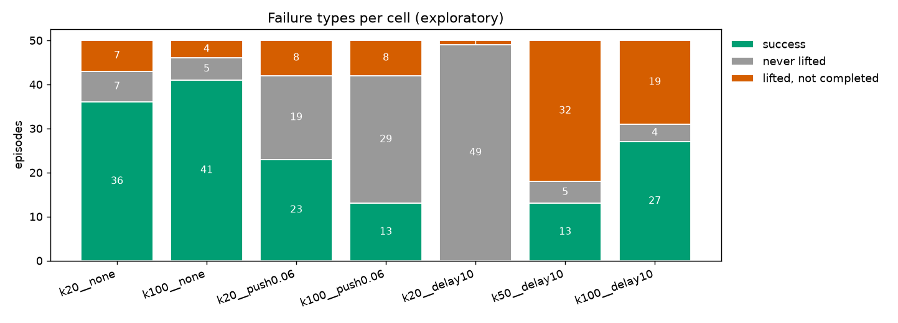
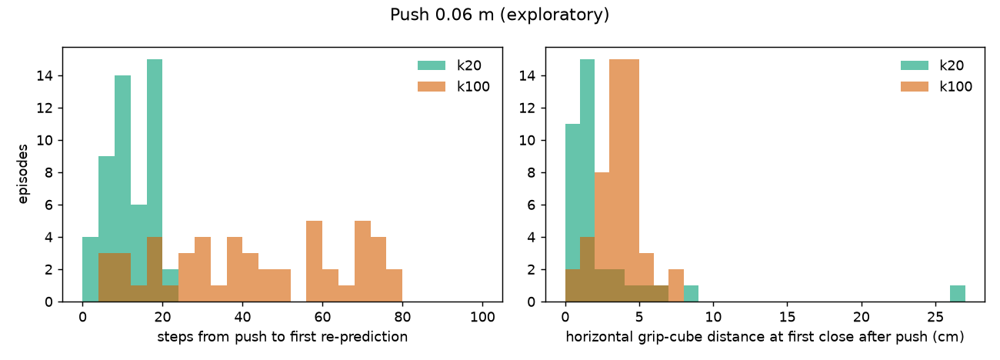
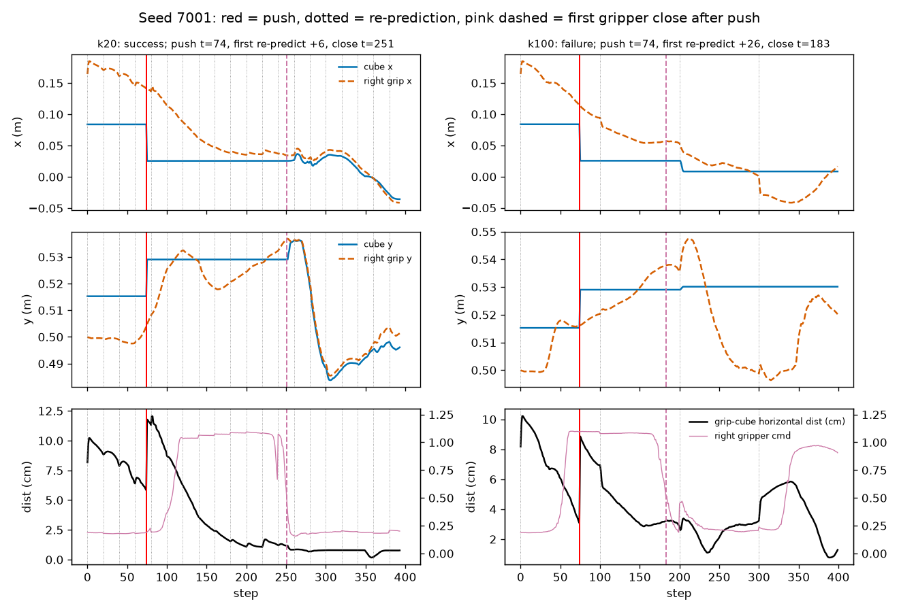
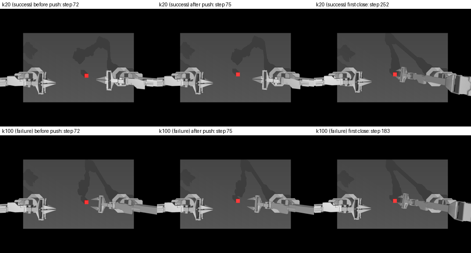
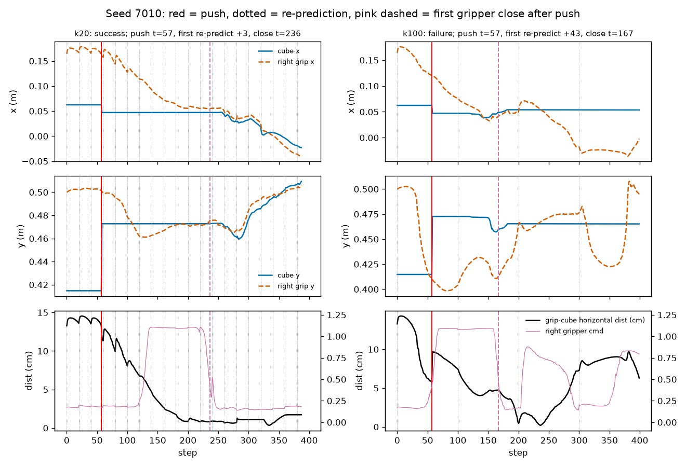
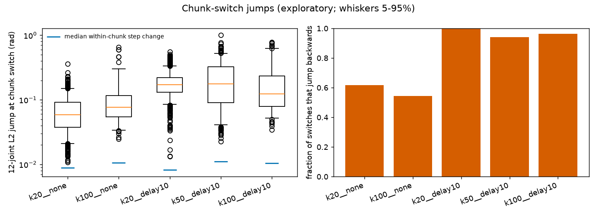
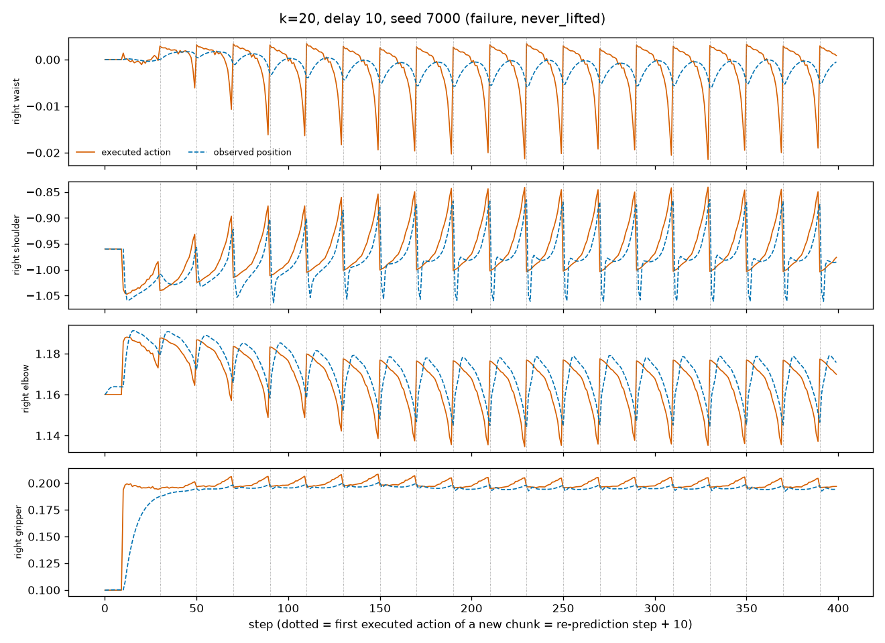
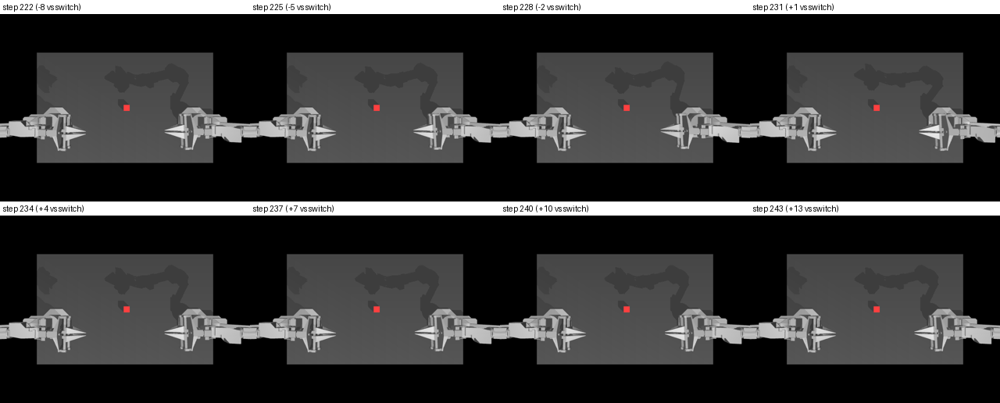

# T13 失败案例分析报告

> **探索性，只描述，不是证据；调试种子 7000–7049，每格 50 回合**

数据：`results/failure`，预训练 ACT，GPU 渲染（`D3D12 (NVIDIA GeForce RTX 4060 Laptop GPU)`），种子 7000–7049（50 个）。格子：`k20__none`（50 回合）、`k100__none`（50 回合）、`k20__push0.06`（50 回合）、`k100__push0.06`（50 回合）、`k20__delay10`（50 回合）、`k50__delay10`（50 回合）、`k100__delay10`（50 回合）。
缺的格子：无。
定义和阈值见 `results/failure/definitions.md`（在看 7000–7049 数据之前提交，之后不改）。
本报告由 `scripts/analyze_failure.py report` 自动生成，数字全部由各格 `episodes.csv` 和 `traj/*.npz` 算出。

## 1. 失败类型（每格三类各多少）

| 格子 | 回合 | 成功 | 从没抓起 | 抓起但没完成 |
|---|---|---|---|---|
| k20__none | 50 | 36 | 7 | 7 |
| k100__none | 50 | 41 | 5 | 4 |
| k20__push0.06 | 50 | 23 | 19 | 8 |
| k100__push0.06 | 50 | 13 | 29 | 8 |
| k20__delay10 | 50 | 0 | 49 | 1 |
| k50__delay10 | 50 | 13 | 5 | 32 |
| k100__delay10 | 50 | 27 | 4 | 19 |

## 2. Q1 推 0.06 m：为什么 k=100 失败多、k=20 成功多

推的时刻在每回合由种子决定，同一种子在 k=20 / k=100 下相同。“推后第一次重新预测”= 推之后（t > 推的步）第一次重新预测距推的步数；“推后第一次闭合”= 推之后右夹爪指令第一次完成“张开 → 闭合”（定义见 definitions.md §3），距离 = 那一步右手两指尖中点与方块中心的水平距离；“计划年龄”= 闭合那一步执行的动作块是多少步之前预测的（k=20 最多 19，k=100 最多 99）。

| 格子 | 推了 / 状态 | 推的步 中位数（四分位） | 推后第一次重新预测（步）：n / 中位数 / 四分位 / p90 / 均值 | 推后第一次闭合距推（步）中位数 | 闭合时水平距离（m）：n / 中位数 / 四分位 / p90 / 均值 | 闭合时计划年龄（步）中位数（范围） | 推后没有闭合 | 闭合在推后第一次重新预测之前 |
|---|---|---|---|---|---|---|---|---|
| k20__push0.06 | pushed 50 | 59（38–76） | 50 / 11.0 / 7.2–17.0 / 19.0 / 11.7 | 146 | 35 / 0.013 / 0.009–0.021 / 0.052 / 0.026 | 13（0–19） | 15 | 0/35 |
| k100__push0.06 | pushed 50 | 59（38–76） | 50 / 41.0 / 24.5–62.2 / 73.1 / 42.5 | 102 | 50 / 0.038 / 0.028–0.043 / 0.051 / 0.037 | 58（10–97） | 0 | 0/50 |

按结局分开的闭合时水平距离（m，中位数 / n）：

| 格子 | 成功 | 从没抓起 | 抓起但没完成 |
|---|---|---|---|
| k20__push0.06 | 0.012（n=23） | 0.072（n=4） | 0.014（n=8） |
| k100__push0.06 | 0.027（n=13） | 0.040（n=29） | 0.038（n=8） |

同一种子配对（k=20 结局 / k=100 结局）：成/成 9，成/败 14，败/成 4，败/败 23。

挑选规则：k=20 成功、k=100 失败的配对里，按种子升序先取两格都存了画面的，不够再取没画面的（只画曲线）。挑中：[7001, 7010]。

### 种子 7001

- k=20：推在第 74 步，推后 +6 步重新预测，推后第一次闭合在第 251 步，水平距离 0.012 m；
- k=100：推在第 74 步，推后 +26 步重新预测，推后第一次闭合在第 183 步，水平距离 0.032 m。

（上行 k=20，下行 k=100；推之前 / 推之后 / 推后第一次闭合，最近的存图步）

### 种子 7010

- k=20：推在第 57 步，推后 +3 步重新预测，推后第一次闭合在第 236 步，水平距离 0.009 m；
- k=100：推在第 57 步，推后 +43 步重新预测，推后第一次闭合在第 167 步，水平距离 0.048 m。

（这个种子没有存画面，不做拼图）

## 3. Q2 延迟 10 步：换块时刻的跳变

跳变 = 新块第一个**被执行**的动作（延迟 d 时 = 第 t_r + d 步，t_r 为重新预测的步，不含第 0 步的初始块）减去上一步执行的动作；“块内”= 其余相邻两步（参照）。单位：关节为弧度，夹爪为归一化开合度。“往回跳比例”= 跳变（12 关节）与跳变前 5 步运动方向的余弦 < 0 的比例。k=50 无扰动不在 7 格内，所以没有。

| 格子 | 12 关节 L2 跳变：换块数 n / 中位数 / 四分位 / p90 / 均值 | 块内 12 关节 中位数 | 换块 2 夹爪 中位数 / p90 | 块内 2 夹爪 中位数 | 换块 14 维 中位数 / p90 | 往回跳比例 | 每回合换块次数 中位数（最小–最大） |
|---|---|---|---|---|---|---|---|
| k20__none | 863 / 0.0582 / 0.0377–0.0917 / 0.1260 / 0.0690 | 0.0089 | 0.0134 / 0.1079 | 0.0014 | 0.0723 / 0.1637 | 0.62 | 17（14–19） |
| k100__none | 116 / 0.0767 / 0.0543–0.1163 / 0.2632 / 0.1158 | 0.0105 | 0.0342 / 0.2237 | 0.0018 | 0.1015 / 0.3611 | 0.54 | 2（2–3） |
| k20__delay10 | 950 / 0.1719 / 0.1314–0.2210 / 0.2731 / 0.1830 | 0.0082 | 0.0097 / 0.0209 | 0.0009 | 0.1765 / 0.3037 | 1.00 | 19（19–19） |
| k50__delay10 | 348 / 0.1754 / 0.0907–0.3243 / 0.4715 / 0.2237 | 0.0111 | 0.0348 / 0.4507 | 0.0018 | 0.2453 / 0.5902 | 0.94 | 7（6–7） |
| k100__delay10 | 135 / 0.1236 / 0.0795–0.2355 / 0.4808 / 0.2005 | 0.0104 | 0.0302 / 0.2753 | 0.0017 | 0.1603 / 0.5881 | 0.96 | 3（2–3） |

### k=20 延迟 10 失败回合：种子 7000（挑选规则：失败且存了画面的种子里最小的）

画面：这一回合 12 关节跳变最大的换块执行步 230 前后。

## 注意

- 全部是**探索性描述**：每格 50 回合、调试种子，不做假设检验，不能当证据；机制解释只是与数据相符的说法。
- GPU 渲染逐回合不完全可复现（T2），同一种子重跑结局可能不同；本报告与正式结果（种子 200000–200199）不是同一批回合。
- 指尖位置 = 手指网格最前端 5 mm 内顶点的平均（definitions.md §3），不是接触点。
