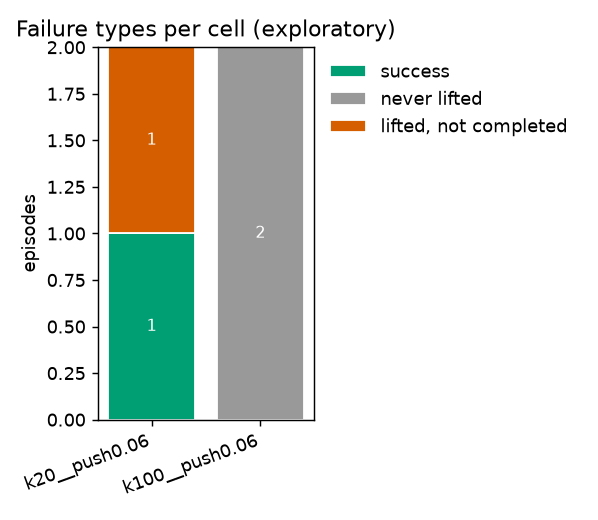
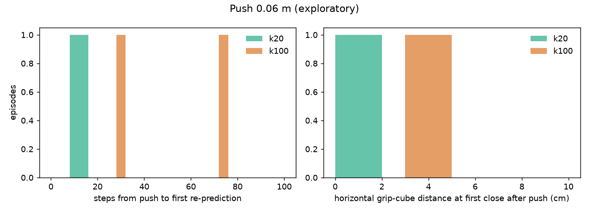
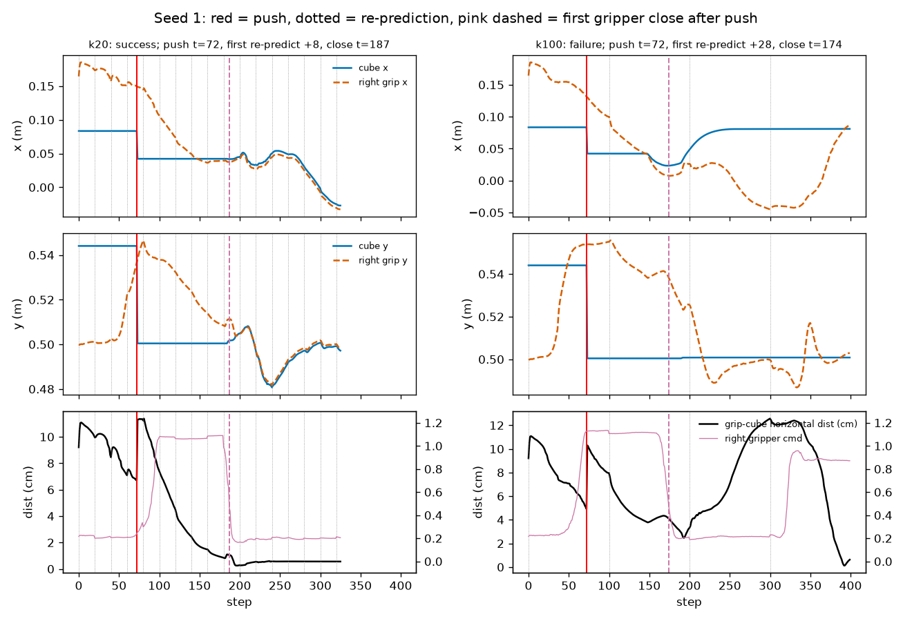
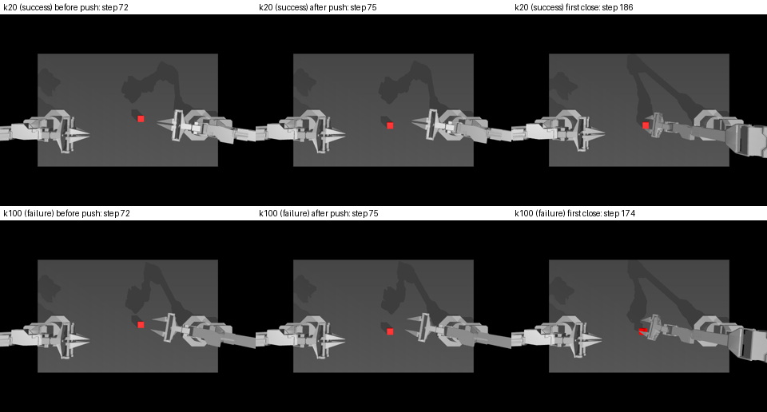

# T13 失败案例分析报告

> **冒烟运行：种子 0–1、2 格、每格 2 回合，只证明流程能跑，不是结果**

数据：`results/failure_smoke`，预训练 ACT，GPU 渲染（`D3D12 (NVIDIA GeForce RTX 4060 Laptop GPU)`），种子 0–1（2 个）。格子：`k20__push0.06`（2 回合）、`k100__push0.06`（2 回合）。
缺的格子：`k20__none`、`k100__none`、`k20__delay10`、`k50__delay10`、`k100__delay10`。
定义和阈值见 `results/failure/definitions.md`（在看 7000–7049 数据之前提交，之后不改）。
本报告由 `scripts/analyze_failure.py report` 自动生成，数字全部由各格 `episodes.csv` 和 `traj/*.npz` 算出。

## 1. 失败类型（每格三类各多少）

| 格子 | 回合 | 成功 | 从没抓起 | 抓起但没完成 |
|---|---|---|---|---|
| k20__push0.06 | 2 | 1 | 0 | 1 |
| k100__push0.06 | 2 | 0 | 2 | 0 |

## 2. Q1 推 0.06 m：为什么 k=100 失败多、k=20 成功多

推的时刻在每回合由种子决定，同一种子在 k=20 / k=100 下相同。“推后第一次重新预测”= 推之后（t > 推的步）第一次重新预测距推的步数；“推后第一次闭合”= 推之后右夹爪指令第一次完成“张开 → 闭合”（定义见 definitions.md §3），距离 = 那一步右手两指尖中点与方块中心的水平距离；“计划年龄”= 闭合那一步执行的动作块是多少步之前预测的（k=20 最多 19，k=100 最多 99）。

| 格子 | 推了 / 状态 | 推的步 中位数（四分位） | 推后第一次重新预测（步）：n / 中位数 / 四分位 / p90 / 均值 | 推后第一次闭合距推（步）中位数 | 闭合时水平距离（m）：n / 中位数 / 四分位 / p90 / 均值 | 闭合时计划年龄（步）中位数（范围） | 推后没有闭合 | 闭合在推后第一次重新预测之前 |
|---|---|---|---|---|---|---|---|---|
| k20__push0.06 | pushed 2 | 50（38–61） | 2 / 10.5 / 9.2–11.8 / 12.5 / 10.5 | 152 | 2 / 0.008 / 0.007–0.009 / 0.010 / 0.008 | 12（7–16） | 0 | 0/2 |
| k100__push0.06 | pushed 2 | 50（38–61） | 2 / 50.5 / 39.2–61.8 / 68.5 / 50.5 | 132 | 2 / 0.036 / 0.034–0.039 / 0.040 / 0.036 | 82（74–90） | 0 | 0/2 |

按结局分开的闭合时水平距离（m，中位数 / n）：

| 格子 | 成功 | 从没抓起 | 抓起但没完成 |
|---|---|---|---|
| k20__push0.06 | 0.011（n=1） | —（n=0） | 0.005（n=1） |
| k100__push0.06 | —（n=0） | 0.036（n=2） | —（n=0） |

同一种子配对（k=20 结局 / k=100 结局）：成/成 0，成/败 1，败/成 0，败/败 1。

挑选规则：k=20 成功、k=100 失败的配对里，按种子升序先取两格都存了画面的，不够再取没画面的（只画曲线）。挑中：[1]。

### 种子 1

- k=20：推在第 72 步，推后 +8 步重新预测，推后第一次闭合在第 187 步，水平距离 0.011 m；
- k=100：推在第 72 步，推后 +28 步重新预测，推后第一次闭合在第 174 步，水平距离 0.041 m。

（上行 k=20，下行 k=100；推之前 / 推之后 / 推后第一次闭合，最近的存图步）

## 3. Q2 延迟 10 步：换块时刻的跳变

（没有相关格子，跳过）

## 注意

- 全部是**探索性描述**：每格 50 回合、调试种子，不做假设检验，不能当证据；机制解释只是与数据相符的说法。
- GPU 渲染逐回合不完全可复现（T2），同一种子重跑结局可能不同；本报告与正式结果（种子 200000–200199）不是同一批回合。
- 指尖位置 = 手指网格最前端 5 mm 内顶点的平均（definitions.md §3），不是接触点。
